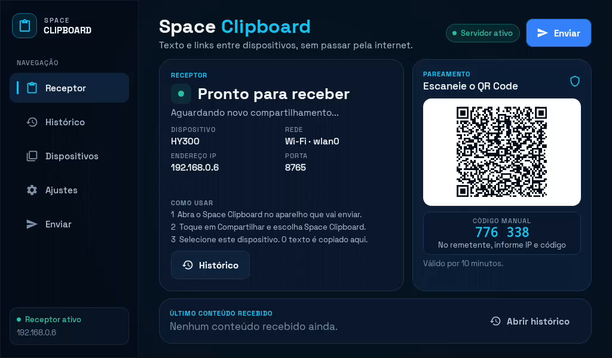
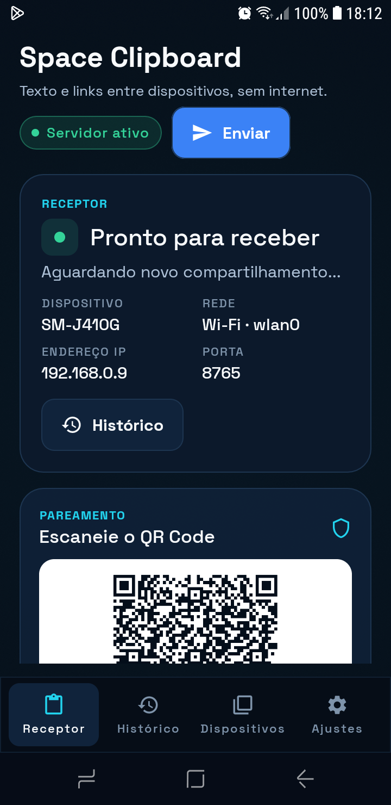
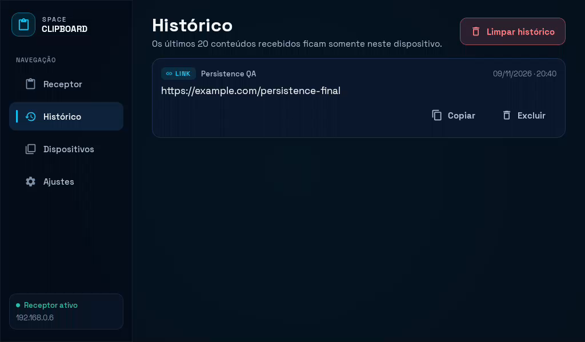
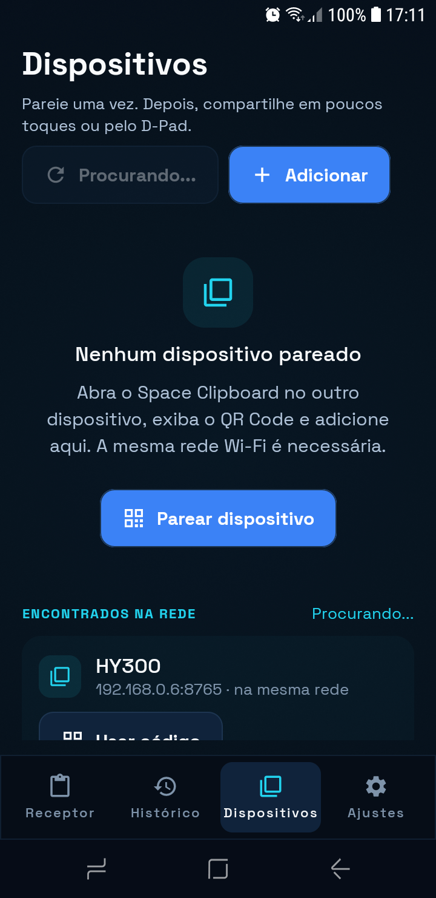
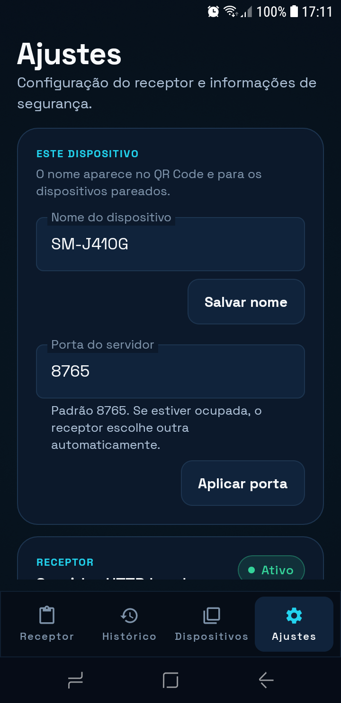
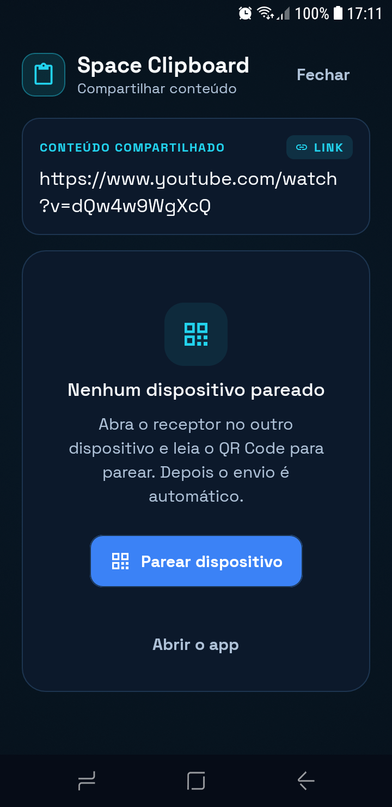
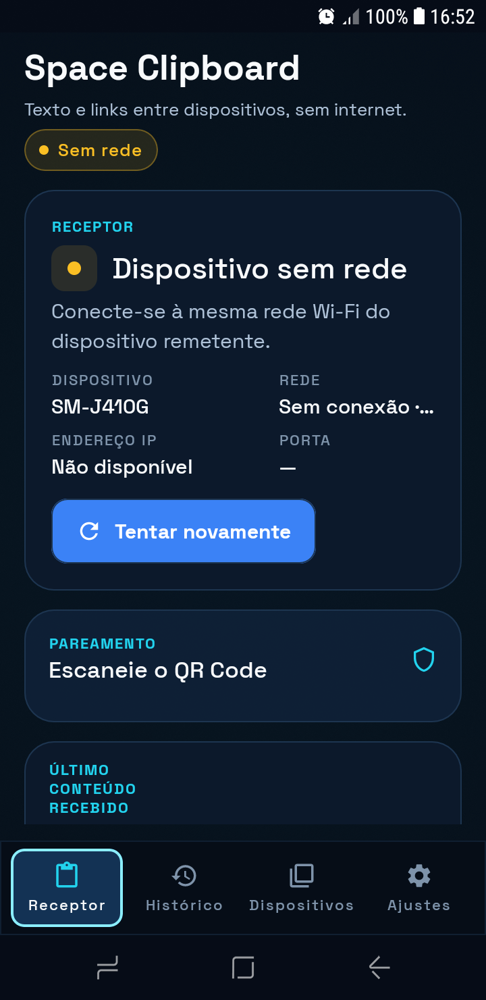
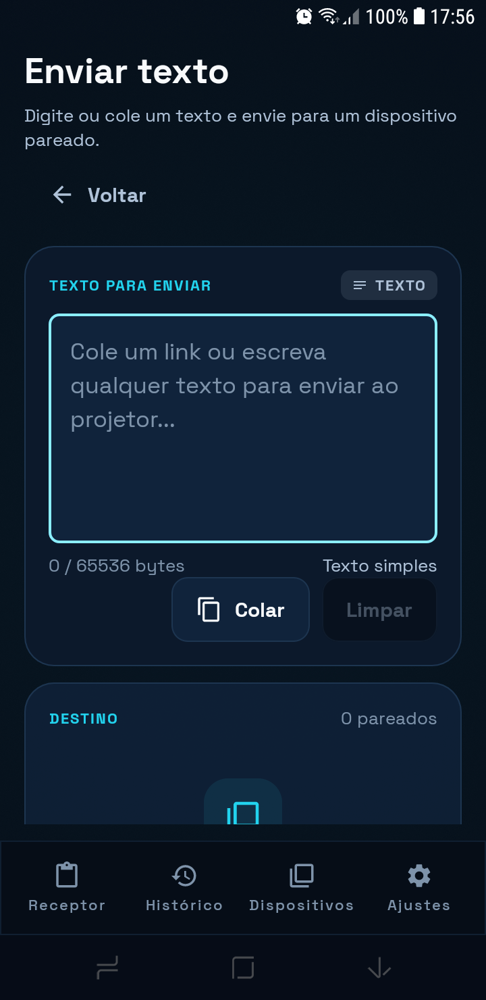
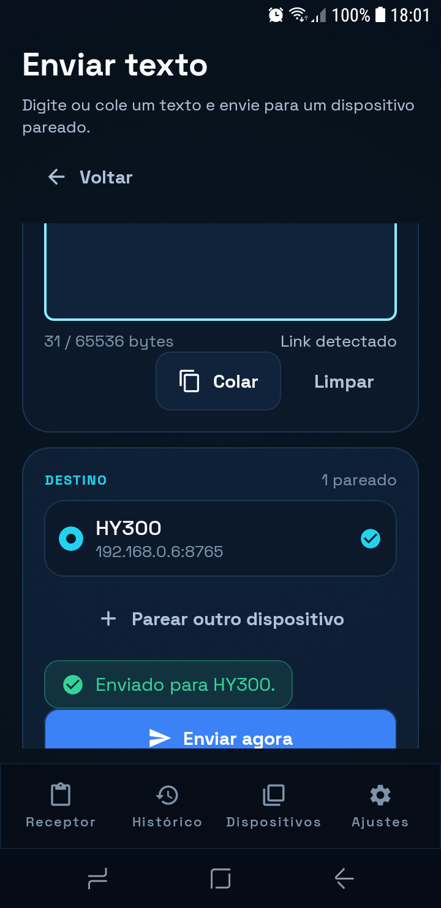

# Space Clipboard

Aplicativo Android nativo para compartilhar textos e links entre dispositivos na mesma rede Wi-Fi local, sem nuvem, sem conta e sem internet.

Fluxo principal: **abrir → receber → copiar → utilizar → fechar**.



## Estado do projeto

Aplicativo funcional, compilado e testado em dispositivos reais:

- **HY300**: Android 11 / API 28, Rockchip RK3326 ARMv7, 1 GB de RAM, tela 1024 × 600 (160 dpi), controle por D-PAD.
- **Samsung SM-J410G**: Android 8.1 / API 27, 720 × 1480 (320 dpi).
- Comunicação real por HTTP na LAN, descoberta NSD/mDNS, pareamento por QR Code/código, histórico em Room, cópia automática para o clipboard e envio pelo `ACTION_SEND`.
- Teste ponta a ponta realizado: celular → Sharesheet → HY300 → conteúdo recebido → clipboard verificado.
- Envio manual real realizado: texto digitado na tela **Enviar texto** do celular, enviado ao HY300, recebido e copiado.
- Teste de ciclo de vida realizado: servidor encerrado ao mandar o app para segundo plano e reiniciado ao reabrir.
- Teste de perda e recuperação de Wi-Fi realizado no celular.

HY320 não estava disponível no ambiente. O app não usa APIs específicas do HY300/HY320 e deve funcionar em outros Android/Android TV dentro dos requisitos de rede.

## O que já está pronto

| Área | Implementação |
|---|---|
| Interface | Jetpack Compose, tema escuro, design system próprio, componentes reutilizáveis |
| TV/D-PAD | foco visível, `FocusRequester`, `focusGroup`, diálogos navegáveis e alvos ≥ 48 dp |
| Receptor | servidor Ktor CIO em primeiro plano, anúncio NSD, QR Code, status em tempo real |
| Remetente | Sharesheet (`ACTION_SEND`/`text/plain`), seleção de destino, envio direto com um único dispositivo |
| Envio manual | tela **Enviar texto** no próprio app, com editor, contador de 64 KB, colar do clipboard, seleção de destino e feedback |
| Pareamento | QR Code temporário (10 min, uso único), código manual de 6 dígitos, credenciais por dispositivo |
| Segurança | Bearer token por dispositivo, hash SHA-256 no receptor, AES-GCM, rate limit no pareamento |
| Persistência | Room para histórico e dispositivos; DataStore para nome/porta/ID; limite de 20 registros |
| Histórico | copiar novamente, excluir, limpar com confirmação, persistência local |
| Descoberta | Android NSD/mDNS, uma varredura por demanda, sem polling |
| Clipboard | `ClipboardManager`, cópia automática somente em primeiro plano |
| Ciclo de vida | sem `Service`, `WorkManager`, `AlarmManager`, notificações ou receivers de inicialização |
| Testes | 33 testes JVM + 4 testes instrumentados padrão + 2 testes opcionais de integração real |

## Capturas

| Celular | Histórico no HY300 |
|---|---|
|  |  |

| Dispositivos | Ajustes |
|---|---|
|  |  |

| Compartilhar | Sem Wi-Fi |
|---|---|
|  |  |

| Enviar texto manualmente | Confirmação do envio |
|---|---|
|  |  |

## Instalação

### APKs prontos

A pasta [`dist/`](dist/) contém:

- `space-clipboard-release-optimized.apk` — **recomendado**, minificado, 4,2 MB, inicialização rápida. Assinado com a chave de teste do projeto; para distribuição, gere sua própria chave.
- `space-clipboard-debug.apk` — APK de depuração, instalável, com `debuggable=true`. É maior e mais lento em hardware de 1 GB.
- `SHA256SUMS.txt` — checksums.

Instalação por ADB:

```bash
adb install -r dist/space-clipboard-release-optimized.apk
```

Repita em cada dispositivo. Se estiver trocando entre debug e release, desinstale antes (assinaturas diferentes):

```bash
adb uninstall com.spaceclipboard.app
adb install dist/space-clipboard-release-optimized.apk
```

Requisitos:

- Android 8.1 (API 27) ou superior; o projeto usa **minSdk 27**.
- Mesma rede Wi-Fi local.
- Permissão de câmera é opcional, apenas para ler o QR Code.

## Como usar

### 1. Abrir o receptor

Abra o Space Clipboard no dispositivo que vai receber (projetor, TV ou celular).

Você verá:

- status do servidor;
- nome do dispositivo;
- rede, endereço IPv4 e porta;
- QR Code e código manual de 6 dígitos;
- último conteúdo recebido.

O servidor existe **somente enquanto o app está em primeiro plano**. Ao sair, ele é encerrado e a porta é liberada.

### 2. Parear

No receptor, deixe o QR Code visível.

No remetente:

1. abra o Space Clipboard;
2. toque em **Dispositivos** → **Adicionar**;
3. escolha **Ler QR Code** ou informe IP, porta e o código de 6 dígitos;
4. confirme o pareamento.

O código expira em 10 minutos. Depois de um pareamento, um novo código é gerado automaticamente.

### 3. Enviar um texto manualmente (sem Compartilhar)

No app do remetente:

1. toque em **Enviar** no topo da tela inicial;
2. digite ou cole o texto no editor (o botão **Colar** usa o clipboard atual);
3. escolha o dispositivo pareado;
4. toque em **Enviar agora**.

A tela mostra “Enviado para …” ou o erro de conexão. O texto pode ser um link ou qualquer texto simples; o contador mostra o limite de 64 KB em bytes.

Isso não substitui o Sharesheet: as duas formas de envio usam o mesmo cliente HTTP e as mesmas credenciais.

### 4. Compartilhar um link

1. Abra o Chrome (ou qualquer app com texto);
2. use **Compartilhar**;
3. escolha **Space Clipboard**;
4. escolha o dispositivo;
5. confirme o envio.

Se houver apenas um dispositivo pareado, o app tenta enviar imediatamente. Se houver vários, mostra a tela de seleção. Se o receptor estiver fechado, o app informa que ele está indisponível.

### 5. Receber e colar

Quando o receptor está aberto e recebe o conteúdo:

1. o conteúdo é salvo no histórico;
2. é copiado automaticamente para o clipboard;
3. a tela mostra **“Novo conteúdo recebido e copiado!”**.

Abra outro app no receptor e use **Colar**.

### 6. Histórico

A tela **Histórico** guarda os últimos 20 conteúdos. É possível:

- ver conteúdo, tipo, remetente, data e hora;
- copiar novamente;
- excluir um registro;
- limpar todo o histórico com confirmação.

Tudo fica no banco local do aparelho. Não há sincronização em nuvem.

## Compatibilidade e decisões de versão

### Dispositivos verificados

| | HY300 | SM-J410G |
|---|---|---|
| Android | 11 (API 28) | 8.1 (API 27) |
| ABI | armeabi-v7a | armeabi-v7a |
| RAM | ~1 GB | ~879 MB |
| Tela | 1024 × 600 / 160 dpi | 720 × 1480 / 320 dpi |
| Entrada | D-PAD, teclado | toque |
| Teste | receptor, NSD, servidor, clipboard, D-PAD | sharesheet, servidor, clipboard, testes instrumentados |

### Versões

- `compileSdk = 37`, `targetSdk = 36`, `minSdk = 27`.
- AGP 9.5.1, Kotlin 2.4.21, Compose BOM 2026.09.00.
- Ktor 3.6.1, Room 2.8.5, DataStore 1.3.0, Navigation 2.10.2.
- `minSdk 27` foi escolhido porque o Android 8.1 do SM-J410G foi usado como piso real de teste. O HY300 está em API 28.
- O app não usa APIs de fabricante, nem bibliotecas de UI específicas de TV.
- O APK universal não contém bibliotecas nativas próprias; funciona em ARMv7 e ARM64.

### HY320

Não havia um HY320 disponível. Não foram presumidos versão, RAM ou resolução desse modelo. O projeto evita APIs exclusivas e mantém layout adaptável, mas **a validação física em HY320 não foi realizada**.

## Arquitetura

```text
app/src/main/java/com/spaceclipboard/app/
├── data/
│   ├── db/                  Room: histórico, dispositivos, DAOs
│   ├── DeviceRepository.kt
│   ├── HistoryRepository.kt
│   └── SettingsRepository.kt
├── domain/
│   ├── ClipboardValidator.kt
│   └── model/               modelos de domínio
├── network/
│   ├── Protocol.kt          DTOs e constantes
│   ├── NetworkInfoProvider.kt
│   ├── client/              cliente HTTP Ktor
│   ├── discovery/           NSD/mDNS (registro e descoberta)
│   └── server/              servidor Ktor CIO e API
├── pairing/                 QR, sessão temporária, credenciais
├── security/                tokens e AES-GCM
├── clipboard/               ClipboardManager
├── receiver/                sessão receptora e lifecycle
├── sender/                  envio e teste de conexão
├── ui/
│   ├── components/
│   ├── screens/
│   ├── share/
│   └── theme/
├── di/AppContainer.kt
├── MainActivity.kt
└── ShareActivity.kt
```

Decisões principais:

- **MVVM** com `MainViewModel` e `ShareViewModel`; controladores de domínio (`ReceiverController`, `DeviceService`, `PairingManager`) concentram rede e sessão.
- **DI manual** em `AppContainer`, sem Hilt para reduzir classes, tempo de build e uso de memória.
- **Ktor CIO** no servidor e cliente. O servidor é iniciado fora de `withContext` para não prender o job do engine (correção importante encontrada no HY300).
- **Nenhum serviço em segundo plano**. `ProcessLifecycleOwner` inicia no `ON_START` e encerra no `ON_STOP`, com geração de ciclo de vida para evitar corrida entre fechar e reabrir rapidamente.
- **Descoberta por demanda**: uma sessão NSD com timeout, nunca polling.
- **Sem WebView**.
- **Histórico e dispositivos** em Room; preferências em DataStore.
- **Credenciais de saída** cifradas com AES-GCM. Em aparelhos sem Keymaster funcional, há fallback local documentado.

Mais detalhes em [`docs/ARQUITETURA.md`](docs/ARQUITETURA.md).

## API local

O receptor escuta somente no IPv4 da rede local, preferencialmente na porta **8765**. Se a porta estiver ocupada, tenta as 10 seguintes e depois uma porta efêmera. O QR Code sempre informa a porta real.

| Método | Rota | Autenticação | Uso |
|---|---|---|---|
| GET | `/api/status` | não | estado, nome, ID, protocolo, porta, pareamento disponível |
| GET | `/api/pair?token=...` ou `?code=...` | token/código | valida o código sem consumir |
| POST | `/api/pair` | token/código | troca credenciais e conclui o pareamento |
| GET | `/api/auth/check` | Bearer | testa uma credencial |
| POST | `/api/clipboard` | Bearer | recebe texto ou URL |
| DELETE | `/api/history/{id}` | Bearer | exclui um registro remoto autenticado |

Exemplo de envio:

```http
POST /api/clipboard HTTP/1.1
Authorization: Bearer <token-do-dispositivo>
Content-Type: application/json

{
  "id": "uuid",
  "text": "https://www.youtube.com/",
  "type": "url",
  "sender": "Samsung Galaxy",
  "timestamp": 1794250000000
}
```

Respostas usam JSON padronizado. Conteúdo novo responde `201`; reenvio do mesmo UUID responde `200` com `duplicate=true`. Erros têm `success=false` e `error.code/message`.

- Limite de texto: **64 KB em UTF-8**.
- Limite de corpo da requisição: 96 KB.
- Timeout do cliente: 4 s para conectar, 8 s para requisição.
- UUID obrigatório e idempotente.
- Requisições autenticadas usam token opaco de 32 bytes; o receptor guarda apenas SHA-256.
- Pareamento tem rate limit por IP e código temporário de 10 minutos.

Detalhes do protocolo e do fluxo de pareamento em [`docs/ARQUITETURA.md`](docs/ARQUITETURA.md).

## Segurança

- Nenhum Firebase, Supabase, servidor externo ou telemetria.
- Comunicação restrita à LAN; o servidor não abre todas as interfaces quando recebe um IPv4 de Wi-Fi.
- Tokens de saída são cifrados com AES-GCM. Quando o aparelho oferece Android Keystore funcional, a chave fica no Keystore. No HY300 o Keymaster falhou; o app usa fallback de chave local no sandbox privado, e isso está registrado no log e neste README.
- Tokens de entrada são armazenados apenas como hash SHA-256.
- QR Code contém token temporário de 128 bits e expiração; não contém credencial permanente.
- O QR Code é de uso único; um novo é gerado após o pareamento.
- Remover um dispositivo revoga a credencial de entrada e apaga a credencial de saída.
- Histórico e banco são locais. `android:allowBackup="false"`.
- Não há logs de conteúdo clipboard.
- **HTTP sem TLS**: o tráfego na LAN não é criptografado. Isso foi escolha consciente para manter compatibilidade com Android 8.1/HY300 e simplicidade. Use uma rede Wi-Fi confiável. Em rede pública ou com isolamento, prefira não usar ou configure uma rede privada/VPN local. TLS local exigiria confiança em certificado autoassinado no receptor e aumentaria a complexidade; não foi ativado nesta versão.

Análise completa em [`docs/SEGURANCA.md`](docs/SEGURANCA.md).

## Permissões

| Permissão | Finalidade |
|---|---|
| `INTERNET` | servidor HTTP local, cliente HTTP e mDNS |
| `ACCESS_NETWORK_STATE` | detectar rede, IPv4 e mudanças de conectividade |
| `ACCESS_WIFI_STATE` | obter `WifiManager` para multicast |
| `CHANGE_WIFI_MULTICAST_STATE` | multicast lock durante NSD/mDNS |
| `CAMERA` | opcional, somente leitura do QR Code de pareamento |

Não são solicitadas localização, acessibilidade, armazenamento amplo, inicialização automática, overlay ou permissões especiais de clipboard.

`uses-feature` marca câmera, touchscreen, Wi-Fi e Leanback como **não obrigatórios**, permitindo instalar em projetores e TVs sem touch/câmera.

## D-PAD e Android TV

- Todos os controles são focáveis, com anel de foco ciano e estado de foco semântico.
- O foco inicial é solicitado para a ação principal de cada tela.
- O foco é restaurado no histórico pelo ID do item.
- Diálogos usam foco inicial seguro: cancelar em ações destrutivas e campo/botão principal nos formulários.
- Alvos interativos têm no mínimo 48 dp.
- Layout usa margens seguras, tipografia legível a distância e duas colunas quando há largura.
- Navegação: `DPAD_UP/DOWN/LEFT/RIGHT`, `DPAD_CENTER`, `ENTER`, `BACK`.
- Teste automatizado com UiAutomator injeta uma tecla D-PAD real e verifica foco no SM-J410G.
- No HY300, a navegação por D-PAD foi exercitada com eventos `KEYCODE_DPAD_*` via ADB: abertura do Histórico por `DPAD_CENTER`, percurso da rail, abertura de Ajustes e retorno com `BACK`. Não foi usado um controle remoto físico no ambiente.
- A tela **Enviar texto** usa os mesmos componentes focáveis; o campo de texto recebe foco inicial e os botões/dispositivos ficam na ordem espacial do D-PAD.
- Em telas largas/Android TV, **Enviar** também aparece como item da rail lateral, selecionável por D-PAD.
- O teste instrumentado de todas as telas no HY300 encontrou uma limitação do ROM customizado ao encerrar Activities de teste; o app em si permaneceu funcional. Ver [`docs/TESTES.md`](docs/TESTES.md).

## Desempenho

Medições no HY300, APK release minificado:

- `Displayed`: **~2,7 s**.
- Servidor ativo: **~2,1 s** após o início do processo.
- PSS total em repouso: **~42 MB**.
- APK release: **4,2 MB**.
- APK debug: **19,5 MB** (sem R8; a inicialização no HY300 chega a ~17 s). Para uso real, instale o release.

O app não faz polling, não mantém serviço em segundo plano, para o servidor/NSD no `ON_STOP` e não usa bibliotecas nativas de UI pesadas.

## Testes

```bash
# JVM: validação, servidor real em porta efêmera, Room/Robolectric, QR
./gradlew testDebugUnitTest

# Instrumentados no dispositivo conectado
./gradlew connectedDebugAndroidTest
```

Resultados da última execução:

- **33 testes JVM**, 0 falhas.
- **4 testes instrumentados** executados, 0 falhas; 2 testes opcionais de integração são ignorados sem argumentos.
- Teste ponta a ponta real: `EndToEndSenderTest` pareou um celular com o HY300 e enviou um link via `ACTION_SEND`; a tela de envio confirmou “Enviado para HY300”.
- Envio manual real: a tela **Enviar texto** do celular enviou `https://example.com/manual-send` para o HY300; o receptor mostrou “Novo conteúdo recebido e copiado!” e o histórico registrou o link.
- Clipboard no HY300: teste instrumentado de recebimento/cópia passou; o conteúdo real foi confirmado no clipboard do HY300 após o envio do celular.
- O teste instrumentado também lê o clipboard de volta por `ClipboardWriter.readText()`, cobrindo o botão **Colar**.
- Servidor em segundo plano: `curl` falhou após HOME e voltou a responder após reabrir.
- Wi-Fi: servidor parou ao desligar o Wi-Fi e voltou ao religar.
- Porta: teste JVM ocupa a porta pedida e confirma fallback e liberação.

Comandos opcionais de integração real:

```bash
adb shell am instrument -w \
  -e class com.spaceclipboard.app.EndToEndSenderTest \
  -e receiverHost 192.168.0.6 \
  -e pairCode 123456 \
  -e expectedText https://example.com/teste \
  com.spaceclipboard.app.test/androidx.test.runner.AndroidJUnitRunner
```

Relatório completo, matriz de cobertura e limitações: [`docs/TESTES.md`](docs/TESTES.md).

## Solução de problemas

### O outro dispositivo não aparece

1. Confirme que os dois estão na **mesma rede Wi-Fi**.
2. Abra o Space Clipboard no receptor; o servidor deve estar **ativo**.
3. Toque em **Procurar na rede** na tela Dispositivos.
4. Se a rede tiver **AP Isolation / isolamento de clientes**, NSD e conexões diretas podem falhar. Desative o isolamento no roteador ou use uma rede sem isolamento.
5. Use o pareamento manual: IP, porta e código de 6 dígitos exibidos no receptor.

### “Dispositivo indisponível”

O receptor provavelmente está fechado ou em segundo plano. O servidor é encerrado de propósito ao sair do app. Abra o Space Clipboard no receptor, confirme “Servidor ativo” e tente novamente.

### QR Code não lê

- Aumente o brilho/zoom da tela do receptor.
- Aproxime a câmera e evite reflexos.
- Use o código manual de 6 dígitos.
- Em projetor sem câmera, o pareamento por QR não é possível no próprio projetor; ele pode receber normalmente e ser pareado pelo celular.

### Porta ocupada

O receptor tenta 8765 e as 10 portas seguintes; se necessário, usa uma porta efêmera. O IP/porta reais aparecem na tela e no QR. Você também pode alterar a porta em Ajustes.

### Clipboard não colou

A cópia automática só ocorre com o app em primeiro plano. O Android pode mostrar o overlay de cópia do sistema (Android 13+) e alguns apps bloqueiam colagem. Abra o histórico e use **Copiar** novamente. O app não tenta contornar restrições de clipboard do Android.

### App fechou e o servidor parou

É o comportamento esperado. Não há serviço em segundo plano. Abra o app novamente; o histórico permanece no Room.

## Build

Pré-requisitos: JDK 17, Android SDK com plataforma 37 e build-tools 36/37, Gradle Wrapper incluído.

```bash
./gradlew assembleDebug
# app/build/outputs/apk/debug/app-debug.apk

./gradlew assembleRelease
# app/build/outputs/apk/release/app-release-unsigned.apk
```

### Assinar o release

1. Gere uma chave **sua** (não use a chave de teste do projeto em distribuição):

```bash
keytool -genkeypair -v \
  -keystore keystore/space-clipboard-release.jks \
  -alias spaceclipboard \
  -keyalg RSA -keysize 4096 -validity 10000
```

2. Crie `keystore.properties` na raiz:

```properties
storeFile=keystore/space-clipboard-release.jks
storePassword=SUA_SENHA
keyAlias=spaceclipboard
keyPassword=SUA_SENHA
```

3. Rode:

```bash
./gradlew clean assembleRelease
```

O build usa a configuração de assinatura quando `keystore.properties` existe. Sem ele, o APK de release fica sem assinatura e precisa ser assinado com `apksigner`.

4. Verifique:

```bash
apksigner verify --print-certs app/build/outputs/apk/release/app-release.apk
```

## Estrutura de entrega

- Código-fonte completo em `app/`.
- `AndroidManifest.xml` em `app/src/main/AndroidManifest.xml`.
- Gradle version catalog em `gradle/libs.versions.toml`.
- Schema Room em `app/schemas/`.
- APKs em `dist/`.
- Screenshots em `docs/screenshots/`.
- Arquitetura em `docs/ARQUITETURA.md`.
- Análise de segurança em `docs/SEGURANCA.md`.
- Relatório de testes/limitações em `docs/TESTES.md`.
- Licença da fonte em `licenses/SpaceGrotesk-OFL.txt` e notas de terceiros em `THIRD_PARTY_NOTICES.md`.

## UI/UX Pro Max

A skill **UI/UX Pro Max** foi carregada e usada como orientação de design. A instalação disponível é a versão reduzida, sem a base pesquisável original; as regras de acessibilidade, contraste, alvos de toque, foco visível, hierarquia, tipografia, responsividade e performance foram aplicadas diretamente no design system e nos componentes.

## Limitações conhecidas

1. **Sem TLS local**: HTTP na LAN. Decisão de compatibilidade; ver Segurança.
2. **Somente IPv4** para o servidor e QR.
3. **HY320 não testado** fisicamente.
4. **QR Code por câmera** não foi exercitado com uma câmera física apontada para outro dispositivo; geração e decodificação do QR são testadas, e o pareamento manual foi validado de ponta a ponta.
5. **Seleção no Chrome** não foi automatizada; o intent `ACTION_SEND` foi resolvido e entregue ao `ShareActivity` em teste real.
6. **Keymaster quebrado no HY300**: o Android Keystore não gera chave AES; o app cai no fallback local. Em aparelhos saudáveis a chave fica no Keystore.
7. **Sem recebimento em segundo plano** por requisito. O app precisa estar aberto no receptor.
8. **Histórico máximo de 20**, por requisito.
9. **Interface em português**; não há tradução completa para outros idiomas.
10. **Teste exaustivo de D-PAD em todas as telas** não foi automatizado no HY300; a navegação principal e o foco foram exercitados por keyevents e o teste UiAutomator cobre foco por D-PAD no celular.
